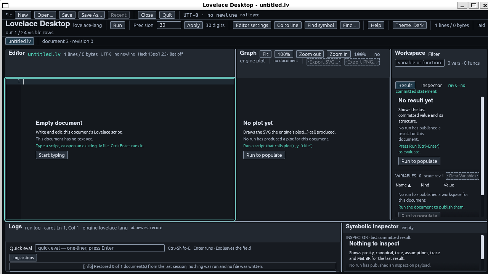

# RustLace

[](https://github.com/jjackbauer/RustLace/actions/workflows/ci.yml)

**A native workbench for precision-controlled mathematical computing.**

RustLace brings arbitrary-precision arithmetic, N-dimensional arrays, symbolic mathematics,
differentiation and series, polynomial solving and digital signal processing into a single scripting
environment. Work interactively in the desktop workbench, or run scripts through the `lovelace-run`
CLI for automation and reproducible results.

The numerical engine uses exact integer and decimal-backed rational representations, with an explicit
precision budget for the operations that cannot be exact. There is no floating-point type in the value
path, and a result carries its kind, precision and exactness metadata instead of hiding them.

RustLace runs natively on **Windows and Linux (X11)**. It is pre-1.0: what is supported, what is only
partly verified and what is known to be wrong are listed under [Current limitations](#current-limitations).

**Try a calculation**

```console
$ cargo run -p lovelace-run -- --eval "1/3" --text
= 0.(3) (Real)
  _ = 0.(3)
```

`0.(3)` is the exact repeating-decimal representation of one third, not an approximation rendered to
some number of places.

**Get started:** [download the latest release](https://github.com/jjackbauer/RustLace/releases/latest) ·
[build and run](docs/build-and-run.md) · [the four tutorials](docs/tutorials/README.md) ·
[language reference](docs/language/README.md)

## Current limitations

- **Pre-1.0.** Interfaces change; the changelog and the conventional-commit history are the record.
- **X11 is what is certified on Linux.** Wayland is untested, and on WSLg `WAYLAND_DISPLAY` must be
  unset. GUI journey evidence is captured on Windows only; on Linux the workbench selftest and the
  desktop suite run headlessly rather than opening a window.
- **macOS is not a supported platform.** No macOS host has been used and no claim is made.
- **30-place results are precision-limited, not exact.** "Exact decimal storage" and "mathematically
  exact" are different claims; [precision and formatting](docs/language/precision-and-formatting.md)
  and [the DSP guide](docs/extensions/dsp.md) distinguish them.


The same workbench on Linux (WSLg, X11), captured from the release binary:



**Linux support.** The full workbench builds and runs on Linux/X11 as well as on Windows. The Linux
build selects eframe's `glow` (OpenGL) backend; Windows keeps the default `wgpu` path unchanged.
What is verified is X11: Wayland is not tested, and under WSLg `WAYLAND_DISPLAY` must be unset or
winit picks a Wayland socket WSLg does not provide. The three Win32-only modes (`--legacy-win32`,
`--ime-probe`, `--platform-parity`) are refused by name on Linux. See
[build-and-run.md](docs/build-and-run.md#linux).

**Release assets.** Every release carries both executables and one checksum file per platform:

| Asset | Platform | Notes |
|---|---|---|
| `lovelace-desktop.exe` | Windows x86_64 | needs the Microsoft Visual C++ runtime; unsigned |
| `SHA256SUMS.windows` | -- | `"<sha256>  lovelace-desktop.exe"` |
| `lovelace-desktop-linux-x86_64` | Linux x86_64 | glibc >= 2.39; `chmod +x` before running |
| `SHA256SUMS.linux` | -- | `"<sha256>  lovelace-desktop-linux-x86_64"` |

Both binaries are rebuilt at the tagged release commit and must print the tag's version before they
are attached. The Linux one is built on Ubuntu 24.04 and verified there with software rendering
(mesa's llvmpipe); no GPU driver is claimed. On Linux, download the asset, run
`chmod +x lovelace-desktop-linux-x86_64`, then `./lovelace-desktop-linux-x86_64 --version`; verify
it with `sha256sum -c SHA256SUMS.linux`. The checksum choice and the retry path are in
[docs/release.md](docs/release.md).

## Three entry points

| Surface | What it is | Start it |
|---|---|---|
| **Engine library** | `lovelace-lang`'s `Engine`, over the numeric and array crates | `cargo build --workspace` |
| **`lovelace-run` CLI** | the non-interactive runner and the agent-facing JSON envelope | `cargo run -p lovelace-run -- --eval "1/3" --text` |
| **`lovelace-desktop` GUI** | the native desktop IDE for Windows and Linux (eframe/egui + resvg), with its headless acceptance modes | `cargo run -p lovelace-desktop` |

All three drive the same engine; no host re-implements language behaviour.

## Quick start

Requires Rust 1.85+ (`rust-version` in `Cargo.toml`; the tree was built with 1.100.0) and, on
Windows, the MSVC build tools. The
Linux workbench also needs the X11/GL/font packages listed in
[build-and-run.md](docs/build-and-run.md#linux); a display-less machine can run the acceptance modes
under `xvfb-run`.

```console
$ cargo build --workspace

$ cargo run -p lovelace-run -- --eval "1/3" --text
= 0.(3) (Real)
  _ = 0.(3)

$ cargo run -p lovelace-run -- --eval "1/3"
{"artifacts":[],"elapsed":"407.1 µs",...,"result":{"display":"0.(3)","kind":"Real",...,"typed":"0.(3) (Real)"},...}

$ cargo run --release -p lovelace-corpus
corpus: 231 passed, 0 failed, 231 total

$ cargo test -p lovelace-desktop
test result: ok. <passed> passed; 0 failed; <ignored> ignored; <measured> measured; <filtered> filtered out; finished in <time>

$ cargo run -p lovelace-desktop -- --gui-selftest
GUI_SELFTEST summary checks=20 failed=0

$ cargo run -p lovelace-desktop -- --contrast-check
contrast: every required pair passes (normal text 4.5:1, large text/non-text 3:1)

$ cargo run -p lovelace-desktop -- --shortcuts
lovelace-desktop --shortcuts (A11Y-007)
45 registered bindings, generated from src/keyboard.rs

$ cargo run -p lovelace-bench -- mul 10000 3
RESULT mul 10000 2.018 1.961
DIGEST mul 14999:179894059904715401915510
```

The desktop writes its state under `%APPDATA%\Lovelace` (`desktop.json`, `plots\`, `recovery\`) on
Windows, and under `$XDG_CONFIG_HOME/lovelace` or `~/.config/lovelace` on Linux; point that
directory somewhere writable when running headless. The screenshots in `docs/images` are real
frames of the release build — see [docs/images/README.md](docs/images/README.md) for the binary hash,
the capture method and each frame's provenance.

Test counts and timings depend on the commit, host and test features:
[docs/testing.md](docs/testing.md#1-unit-tests-in-crate-test) is the measured record — commit, OS,
command, counts and date, with the Linux and Windows desktop observations kept separate. Read the
number from your own run instead of copying one from here.

## The crates

Thirteen crates: twelve workspace members plus one standalone spike that is deliberately outside the
workspace.

| Crate | Responsibility | Page |
|---|---|---|
| `lovelace-json` | JSON reader/writer; numbers kept as their source text | [docs/crates/lovelace-json.md](docs/crates/lovelace-json.md) |
| `lovelace-nat` | arbitrary-precision naturals over base-2^64 limbs, NTT multiplication | [docs/crates/lovelace-nat.md](docs/crates/lovelace-nat.md) |
| `lovelace-int` | sign + magnitude integers, truncating division | [docs/crates/lovelace-int.md](docs/crates/lovelace-int.md) |
| `lovelace-real` | reals with exact periodic decimals, `sqrt`, `pi` | [docs/crates/lovelace-real.md](docs/crates/lovelace-real.md) |
| `lovelace-array` | generic `NdArray<T>`, shape algebra, reductions | [docs/crates/lovelace-array.md](docs/crates/lovelace-array.md) |
| `lovelace-symbolics` | canonical expressions, differentiation, series, Gröbner bases, cancellation token | [docs/crates/lovelace-symbolics.md](docs/crates/lovelace-symbolics.md) |
| `lovelace-lang` | values, lexer, parser, interpreter, builtins, static library families, MathIR, SVG plots | [docs/crates/lovelace-lang.md](docs/crates/lovelace-lang.md) |
| `lovelace-systems` | exact queueing/operations research: M/M/1, M/M/c, M/M/∞, laws, networks, MVA, capacity, sweeps | [docs/crates/lovelace-systems.md](docs/crates/lovelace-systems.md) |
| `lovelace-run` | the non-interactive runner and the JSON wire envelope | [docs/crates/lovelace-run.md](docs/crates/lovelace-run.md) |
| `lovelace-know` | the observation-driven behavioural graph | [docs/crates/lovelace-know.md](docs/crates/lovelace-know.md) |
| `lovelace-corpus` | the documentation-corpus parity gate | [docs/crates/lovelace-corpus.md](docs/crates/lovelace-corpus.md) |
| `lovelace-bench` | the shaped-like-the-reference micro-benchmark harness | [docs/crates/lovelace-bench.md](docs/crates/lovelace-bench.md) |
| `lovelace-desktop` | the native desktop IDE (Windows and Linux) and its headless acceptance modes | [docs/crates/lovelace-desktop.md](docs/crates/lovelace-desktop.md) |
| `lovelace-desktop-spike` | the measured UI spike that chose eframe/egui (not a member) | [docs/crates/lovelace-desktop-spike.md](docs/crates/lovelace-desktop-spike.md) |

The engine crates have **no external dependencies**: the contract's `[dependencies]` may only
reference workspace crates by path, and the desktop's GUI stack (`eframe`/`egui` 0.37,
`resvg` 0.50) is the only external code, declared in the desktop crate only. eframe keeps its
default wgpu backend on Windows and adds `glow` on other platforms. See
[ADR-001](docs/adr/001-no-external-crates.md).

## Testing

Five layers, each with its own command — the detail is in [docs/testing.md](docs/testing.md).

```console
$ cargo test --workspace
test result: ok. <passed> passed; 0 failed; <ignored> ignored; ...   # one such line per test target

$ cargo run --release -p lovelace-corpus   # the 231-record documentation corpus
$ cargo run -p lovelace-desktop -- --gui-selftest   # 20 workbench checks, Windows and Linux
$ cargo run -p lovelace-desktop -- --journey J-02   # recorded user journeys
```

The workspace total is not repeated here. [docs/testing.md](docs/testing.md#1-unit-tests-in-crate-test)
records the measured aggregate with its commit, OS, command, counts and date; it lists the per-crate
rows, keeps the Linux and Windows desktop observations separate, and names the one ignored test. A
count from an earlier revision is not evidence about this one.

On Linux, CI runs the same `--gui-selftest` and the desktop suite under `xvfb-run`, so the workbench
code is machine-checked there without a display; CI does not open or capture a window, and the
Linux frame in `docs/images` was captured separately on WSLg.

The corpus is the yardstick: `parity/corpus/lang.json` (111 records from the C# language reference,
99 value / 10 error / 1 prints / 1 plot) plus `parity/corpus/symbolics.json` (103 records). A missing
corpus file is exit code 2, never a pass. Run the gate in release: on this host the debug binary
overflows its main-thread stack at `lang/061`, while the release build of the same sources passes all
214.

## Documentation

| Page | What it covers |
|---|---|
| [AGENTS.md](AGENTS.md) | portable contributor guide: entry points, commands, layout, conventions and guardrails |
| [docs/skills.md](docs/skills.md) | the nine task skills for extending the application, with when-to-use guidance |
| [docs/README.md](docs/README.md) | the index of everything below |
| [docs/tutorials/](docs/tutorials/README.md) | four end-to-end tutorials: linear algebra, symbolic, signal processing and the reproducible JSON envelope |
| [docs/architecture.md](docs/architecture.md) | the five layers, threading, cancellation, the cache, the data flow of a run |
| [docs/build-and-run.md](docs/build-and-run.md) | prerequisites, profiles, the CLI and the GUI, environment variables, troubleshooting |
| [docs/testing.md](docs/testing.md) | the test layers, exact commands and counts, subsets, what cannot run in CI |
| [docs/extending.md](docs/extending.md) | add a builtin, a statically integrated library family, a UI pane, a diagnostic, a fixture |
| [docs/parity-with-studio.md](docs/parity-with-studio.md) | what the port preserves, where it differs, the fixtures that pin it |
| [docs/release.md](docs/release.md) | versioning, the release build, the signing caveat, the checklist |
| [docs/contributing.md](docs/contributing.md) | workflow, commit style, review expectations, definition of done |
| [docs/glossary.md](docs/glossary.md) | Real, LReal64/128, library family, MathIR, statement boundary, precision |
| [docs/adr/](docs/adr/) | nine architecture decision records |
| [docs/crates/](docs/crates/) | one page per crate |
| [docs/images/README.md](docs/images/README.md) | the screenshots and how they were captured |
| [CONTRACT.md](CONTRACT.md) | the workspace contract: crates, fixed APIs, rendering rules, corpus |

## Licence and attribution

RustLace is released under the [MIT licence](LICENSE). The full text, including the copyright line
`Copyright (c) 2025 The RustLace Authors`, is in [`LICENSE`](LICENSE). MIT permits use, modification
and redistribution, including commercially, provided the copyright notice and permission notice are
retained. The project began as the C# LovelaceSharp stack; that codebase is a separate work, and the
Rust port in this repository is the licensed work here. The workspace declares `license = "MIT"`
(`[workspace.package]` in `Cargo.toml`) and every member crate inherits it with
`license.workspace = true`.

RustLace is the Rust-only successor of LovelaceSharp, which in turn descends from a C++ codebase
(`Legacy/`, originally in Portuguese) and is named after
[Ada Lovelace](https://en.wikipedia.org/wiki/Ada_Lovelace). The port keeps the reference's names and
contract in comments deliberately: a comment citing "the reference's …" is a receipt for a behaviour
the Rust code reproduces, not a leftover. The C# sources, its tests and its history remain in the
LovelaceSharp repository; the fixtures that had to travel with the tests are described in
[docs/rustlace-notes.md](docs/rustlace-notes.md).
