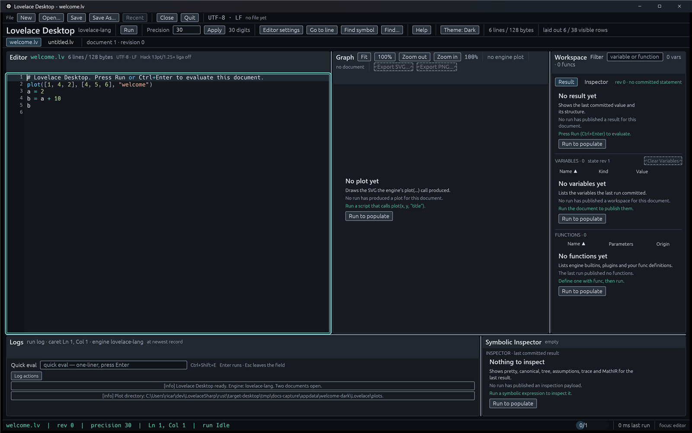

# RustLace

[](https://github.com/jjackbauer/RustLace/actions/workflows/ci.yml)

> The Lovelace stack — arbitrary-precision exact arithmetic, an N-dimensional array library, the
> Lovelace scripting language and a native Windows IDE — in Rust, in one workspace, with no external
> crates under the engine.

RustLace is the Rust-only successor of the [LovelaceSharp](https://github.com/jjackbauer/LovelaceSharp)
stack. It keeps the behaviour the C# implementation defined — exact periodic decimals, the rendered
text, the error sentences, the wire envelope — and replaces the browser IDE with a native workbench.
There is no HTTP server and no browser runtime in the shipped product.



## Three entry points

| Surface | What it is | Start it |
|---|---|---|
| **Engine library** | `lovelace-lang`'s `Engine`, over the numeric and array crates | `cargo build --workspace` |
| **`lovelace-run` CLI** | the non-interactive runner and the agent-facing JSON envelope | `cargo run -p lovelace-run -- --eval "1/3" --text` |
| **`lovelace-desktop` GUI** | the native Windows IDE (eframe/egui + resvg), with nine headless modes | `cargo run -p lovelace-desktop` |

All three drive the same engine; no host re-implements language behaviour.

## Quick start

Requires Rust 1.85+ (the tree was built with 1.99.1) and, on Windows, the MSVC build tools. See
[build-and-run.md](docs/build-and-run.md) for the full prerequisites.

```console
$ cargo build --workspace

$ cargo run -p lovelace-run -- --eval "1/3" --text
= 0.(3) (Real)
  _ = 0.(3)

$ cargo run -p lovelace-run -- --eval "1/3"
{"artifacts":[],"elapsed":"407.1 µs",...,"result":{"display":"0.(3)","kind":"Real",...,"typed":"0.(3) (Real)"},...}

$ cargo run --release -p lovelace-corpus
corpus: 214 passed, 0 failed, 214 total

$ cargo test -p lovelace-desktop
test result: ok. 716 passed; 0 failed; 0 ignored; 0 measured; 0 filtered out; finished in 12.79s

$ cargo run -p lovelace-desktop -- --gui-selftest
GUI_SELFTEST summary checks=20 failed=0

$ cargo run -p lovelace-desktop -- --contrast-check
contrast: every required pair passes (normal text 4.5:1, large text/non-text 3:1)

$ cargo run -p lovelace-desktop -- --shortcuts
lovelace-desktop --shortcuts (A11Y-007)
45 registered bindings, generated from src/keyboard.rs

$ cargo run -p lovelace-bench -- mul 10000 3
RESULT mul 10000 2.018 1.961
DIGEST mul 14999:179894059904715401915510
```

The desktop writes its state under `%APPDATA%\Lovelace` (`desktop.json`, `plots\`, `recovery\`); set
`APPDATA` to a writable directory when running headless. The screenshots in `docs/images` are real
frames of the release build — see [docs/images/README.md](docs/images/README.md) for the binary hash,
the capture method and each frame's provenance.

## The crates

Thirteen crates: twelve workspace members plus one standalone spike that is deliberately outside the
workspace.

| Crate | Responsibility | Page |
|---|---|---|
| `lovelace-json` | JSON reader/writer; numbers kept as their source text | [docs/crates/lovelace-json.md](docs/crates/lovelace-json.md) |
| `lovelace-nat` | arbitrary-precision naturals over base-2^64 limbs, NTT multiplication | [docs/crates/lovelace-nat.md](docs/crates/lovelace-nat.md) |
| `lovelace-int` | sign + magnitude integers, truncating division | [docs/crates/lovelace-int.md](docs/crates/lovelace-int.md) |
| `lovelace-real` | reals with exact periodic decimals, `sqrt`, `pi` | [docs/crates/lovelace-real.md](docs/crates/lovelace-real.md) |
| `lovelace-array` | generic `NdArray<T>`, shape algebra, reductions | [docs/crates/lovelace-array.md](docs/crates/lovelace-array.md) |
| `lovelace-symbolics` | canonical expressions, differentiation, series, Gröbner bases, cancellation token | [docs/crates/lovelace-symbolics.md](docs/crates/lovelace-symbolics.md) |
| `lovelace-lang` | values, lexer, parser, interpreter, builtins, Modus, MathIR, SVG plots | [docs/crates/lovelace-lang.md](docs/crates/lovelace-lang.md) |
| `lovelace-run` | the non-interactive runner and the JSON wire envelope | [docs/crates/lovelace-run.md](docs/crates/lovelace-run.md) |
| `lovelace-know` | the observation-driven behavioural graph | [docs/crates/lovelace-know.md](docs/crates/lovelace-know.md) |
| `lovelace-corpus` | the documentation-corpus parity gate | [docs/crates/lovelace-corpus.md](docs/crates/lovelace-corpus.md) |
| `lovelace-bench` | the shaped-like-the-reference micro-benchmark harness | [docs/crates/lovelace-bench.md](docs/crates/lovelace-bench.md) |
| `lovelace-desktop` | the native Windows IDE and its headless modes | [docs/crates/lovelace-desktop.md](docs/crates/lovelace-desktop.md) |
| `lovelace-desktop-spike` | the measured UI spike that chose eframe/egui (not a member) | [docs/crates/lovelace-desktop-spike.md](docs/crates/lovelace-desktop-spike.md) |

The engine crates have **no external dependencies**: the contract's `[dependencies]` may only
reference workspace crates by path, and the desktop's GUI stack (`eframe`/`egui` 0.37,
`resvg` 0.50) is the only external code, declared Windows-only. See
[ADR-001](docs/adr/001-no-external-crates.md).

## Testing

Five layers, each with its own command — the detail is in [docs/testing.md](docs/testing.md).

```console
$ cargo test --workspace          # 6135 tests (1 ignored), across the twelve crates
$ cargo run --release -p lovelace-corpus   # the 214-record documentation corpus
$ cargo run -p lovelace-desktop -- --gui-selftest   # 20 headless workbench checks
$ cargo run -p lovelace-desktop -- --journey J-02   # recorded user journeys
```

The corpus is the yardstick: `parity/corpus/lang.json` (111 records from the C# language reference,
99 value / 10 error / 1 prints / 1 plot) plus `parity/corpus/symbolics.json` (103 records). A missing
corpus file is exit code 2, never a pass. Run the gate in release: on this host the debug binary
overflows its main-thread stack at `lang/061`, while the release build of the same sources passes all
214.

## Documentation

| Page | What it covers |
|---|---|
| [AGENTS.md](AGENTS.md) | portable contributor guide: entry points, commands, layout, conventions and guardrails |
| [docs/skills.md](docs/skills.md) | the eight task skills for extending the application, with when-to-use guidance |
| [docs/README.md](docs/README.md) | the index of everything below |
| [docs/architecture.md](docs/architecture.md) | the five layers, threading, cancellation, the cache, the data flow of a run |
| [docs/build-and-run.md](docs/build-and-run.md) | prerequisites, profiles, the CLI and the GUI, environment variables, troubleshooting |
| [docs/testing.md](docs/testing.md) | the test layers, exact commands and counts, subsets, what cannot run in CI |
| [docs/extending.md](docs/extending.md) | add a builtin, a Modus plugin, a UI pane, a diagnostic, a fixture |
| [docs/parity-with-studio.md](docs/parity-with-studio.md) | what the port preserves, where it differs, the fixtures that pin it |
| [docs/release.md](docs/release.md) | versioning, the release build, the signing caveat, the checklist |
| [docs/contributing.md](docs/contributing.md) | workflow, commit style, review expectations, definition of done |
| [docs/glossary.md](docs/glossary.md) | Real, LReal64/128, Modus, MathIR, statement boundary, precision |
| [docs/adr/](docs/adr/) | seven architecture decision records |
| [docs/crates/](docs/crates/) | one page per crate |
| [docs/images/README.md](docs/images/README.md) | the screenshots and how they were captured |
| [CONTRACT.md](CONTRACT.md) | the workspace contract: crates, fixed APIs, rendering rules, corpus |

## Licence and attribution

RustLace is released under the [MIT licence](LICENSE). The full text, including the copyright line
`Copyright (c) 2025 The RustLace Authors`, is in [`LICENSE`](LICENSE). MIT permits use, modification
and redistribution, including commercially, provided the copyright notice and permission notice are
retained. The project began as the C# LovelaceSharp stack; that codebase is a separate work, and the
Rust port in this repository is the licensed work here. The workspace declares `license = "MIT"`
(`[workspace.package]` in `Cargo.toml`) and every member crate inherits it with
`license.workspace = true`.

RustLace is the Rust-only successor of LovelaceSharp, which in turn descends from a C++ codebase
(`Legacy/`, originally in Portuguese) and is named after
[Ada Lovelace](https://en.wikipedia.org/wiki/Ada_Lovelace). The port keeps the reference's names and
contract in comments deliberately: a comment citing "the reference's …" is a receipt for a behaviour
the Rust code reproduces, not a leftover. The C# sources, its tests and its history remain in the
LovelaceSharp repository; the fixtures that had to travel with the tests are described in
[docs/rustlace-notes.md](docs/rustlace-notes.md).
