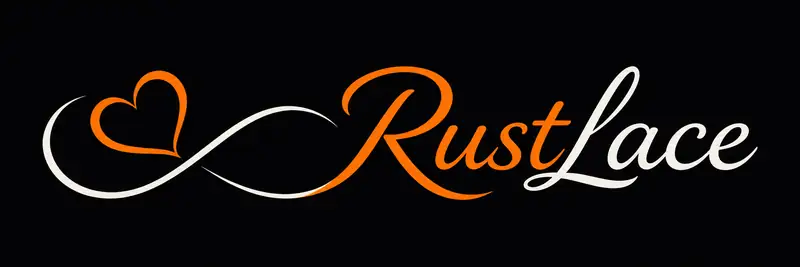

# Documentation index

Start with the [README](../README.md). This directory holds the long-form documentation.

New to RustLace? The [README](../README.md) names the supported platforms (Windows x86_64 and
Linux x86_64/X11) and gives a first runnable script; the [tutorials](tutorials/) run four complete
scripts end to end; [precision and formatting](language/precision-and-formatting.md) and the
[DSP guide](extensions/dsp.md) state the numerical model's limits; the
[language reference](language/) and the [crate pages](crates/) are the API references.

| Page | Read it when |
|---|---|
| [architecture.md](architecture.md) | you need the layering, the threading model, cancellation, the incremental cache, or the data flow of one run |
| [architecture-ownership.md](architecture-ownership.md) | you are adding a numerical type, a crate or a dependency edge, or you need the normative ownership matrix and exception procedure |
| [benchmarks-numerics.md](benchmarks-numerics.md) | you need the measured rational/symbolic/systems benchmark evidence and its environment |
| [build-and-run.md](build-and-run.md) | you are setting up a machine, or a build/launch fails |
| [testing.md](testing.md) | you are changing code and need the commands, the counts, or the layers |
| [rnl-001-evidence.md](rnl-001-evidence.md) | you are reviewing the rational consolidation: commit, commands, observed results and remaining limitations |
| [extending.md](extending.md) | you are adding a builtin, a statically integrated library family, a UI pane, a diagnostic or a fixture |
| [parity-with-studio.md](parity-with-studio.md) | you need to know what the port preserves from the C# Studio and where it deliberately differs |
| [release.md](release.md) | you are cutting a release |
| [contributing.md](contributing.md) | you are opening a change |
| [editorial.md](editorial.md) | you are writing or reviewing documentation, a skill or an agent instruction |
| [tutorials/](tutorials/) | you are learning RustLace by running a complete script end to end |
| [LICENSE](../LICENSE) | you need the terms this repository is released under |
| [glossary.md](glossary.md) | a term is unfamiliar |
| [language/](language/) | you are writing a script and need the syntax, semantics and the builtin catalogue |
| [extensions/](extensions/) | you are using the DSP, Symbolics or MathIR family and need its builtins and limits |
| [rustlace-notes.md](rustlace-notes.md) | you are asking where the carried fixtures came from, or why a C#-era test scans no files |
| [crates/](crates/) | you need one crate's purpose, public surface, dependencies and tests |
| [adr/](adr/) | you want the rationale behind a decision visible in the code |
| [images/README.md](images/README.md) | you want to know how the screenshots were produced |

## Per-crate pages

- [lovelace-json](crates/lovelace-json.md)
- [lovelace-nat](crates/lovelace-nat.md)
- [lovelace-int](crates/lovelace-int.md)
- [lovelace-rational](crates/lovelace-rational.md)
- [lovelace-real](crates/lovelace-real.md)
- [lovelace-array](crates/lovelace-array.md)
- [lovelace-symbolics](crates/lovelace-symbolics.md)
- [lovelace-systems](crates/lovelace-systems.md)
- [lovelace-lang](crates/lovelace-lang.md)
- [lovelace-run](crates/lovelace-run.md)
- [lovelace-know](crates/lovelace-know.md)
- [lovelace-corpus](crates/lovelace-corpus.md)
- [lovelace-bench](crates/lovelace-bench.md)
- [lovelace-desktop](crates/lovelace-desktop.md)
- [lovelace-desktop-spike](crates/lovelace-desktop-spike.md)

## Architecture decision records

- [ADR-001: no external crates in the engine](adr/001-no-external-crates.md)
- [ADR-002: egui/eframe as the native shell](adr/002-egui-eframe.md)
- [ADR-003: cancellation stops at a statement boundary](adr/003-statement-boundary-cancellation.md)
- [ADR-004: 30-digit default precision in the desktop](adr/004-thirty-digit-default.md)
- [ADR-005: the incremental cache is keyed on full canonical strings](adr/005-incremental-cache-keying.md)
- [ADR-006: atomic saves and recorded file identity](adr/006-atomic-save-and-external-change.md)
- [ADR-007: one token set per theme, and a contrast gate that reads the tokens](adr/007-theme-tokens-and-contrast.md)
- [ADR-008: the native workbench runs on Linux as well as Windows](adr/008-linux-gui-support.md)
- [ADR-009: remove the Modus static families](adr/009-remove-modus-static-families.md)
- [ADR-010: transactional cancellation](adr/010-transactional-cancellation.md)
- [ADR-011: one shared rational kernel](adr/011-shared-rational-kernel.md)

## Reference material carried with the tests

These live under `docs/` because tests read them; they are not project documentation.

- `goal-desktop-v4/journeys.md` and `platform-matrix.md` — the journeys `--journey` executes and the
  platform claims `--platform-claims` prints.
- `goal-desktop-v4/reference/REF-*.json` and `goal-desktop-v4/round-64/REF-cancel.json` — the
  captured reference states the desktop's tests compare against.
- `csharp-oracle/` — the C# documentation oracles and the golden wire fixtures.
- `symbolics/dsh-protocol.md` — the protocol examples `lovelace-run` checks.

`parity/corpus/*.json` and `knowledge-graph-demo.json` sit at the repository root because the crates
resolve them from there (`lovelace-corpus/src/main.rs`, `lovelace-know/tests/common/mod.rs`).

One carried document keeps links that do not resolve here: `goal-desktop-v4/journeys.md` cites the
per-journey capture artifacts (`round-33/`, `round-44/`, `round-47/`, `round-61/`, `deviations.md`)
that lived beside it in the LovelaceSharp repository. Those rounds are not part of this repository,
and the file is read by the `--journey` tests for its expected observables, so the links are left
exactly as carried.
