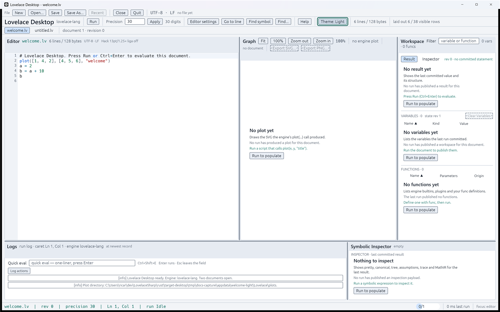

# ADR-007: one token set per theme, and a contrast gate that reads the tokens

**Status:** accepted

## Context

Before the theme module, panes painted `const` colours declared beside each paint routine. A constant
cannot change at runtime, so a light theme was impossible, and nothing measured whether text was
readable. VIS-002 asked for two complete themes; VIS-009 asked for WCAG AA contrast in each,
validated *from rendered colours*.

## Decision

**One module owns every colour.** Every colour the workbench paints is a `Tokens` field in `DARK` or
`LIGHT`; the active set is selected by `ThemeId`, persisted in the settings document, and the
accessors in `lovelace-desktop/src/ui/theme.rs` are what paint routines call. `theme.rs` is the only
module in `ui/` allowed to construct a `Color32`, and a test in that file enforces it
(`theme.rs:9`–`11`). egui's own widgets are not left on egui's palette: `visuals` derives the
complete `egui::Visuals` from the same tokens (`theme.rs:19`–`23`).

**The gate reads the tokens.** `checks` computes WCAG 2.1 ratios from the rendered `Color32`s,
compositing translucent states (disabled text, shadows) over their backdrop exactly as the renderer
blends them. Normal text must reach 4.5:1; large text and non-text indicators 3:1. Exempt pairs are
still measured and printed with the reason they are exempt; only non-exempt failures make
`--contrast-check` exit non-zero (`theme.rs:25`–`37`).

## Consequences

- A new literal colour in a paint routine fails the suite instead of escaping the theme.
- The pair list is deliberately broader than the current paint sites, so reusing a role on a new
  surface usually fails the checker rather than shipping unreadable text.
- Theme switching touches no document state: the token set is not part of the document model.

