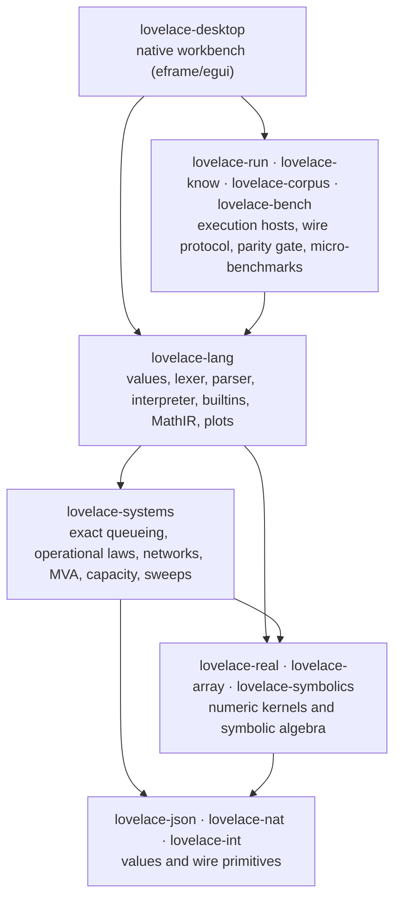
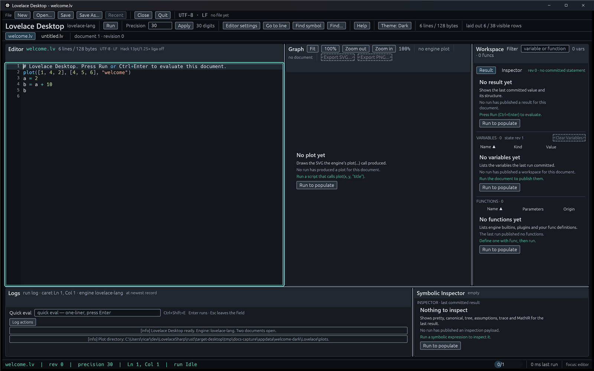
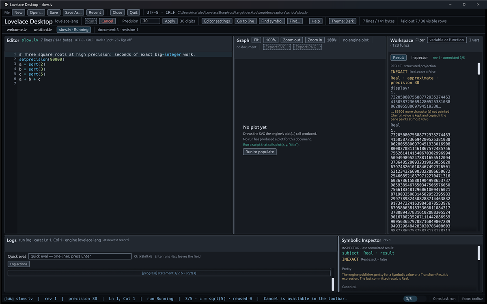
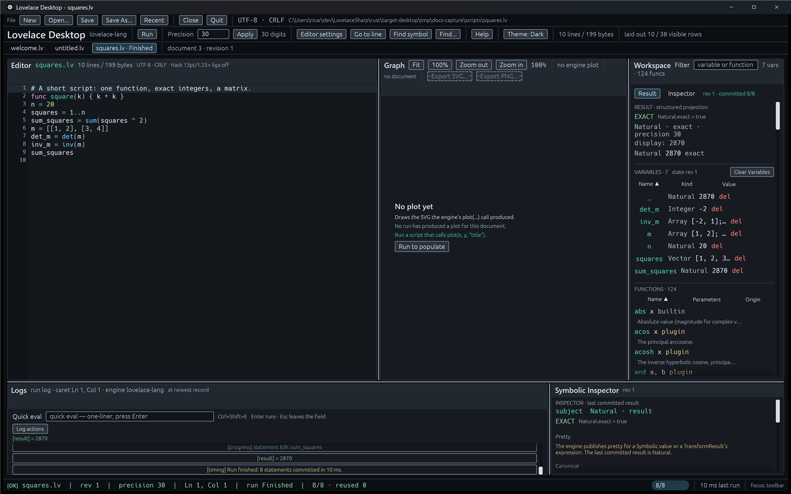
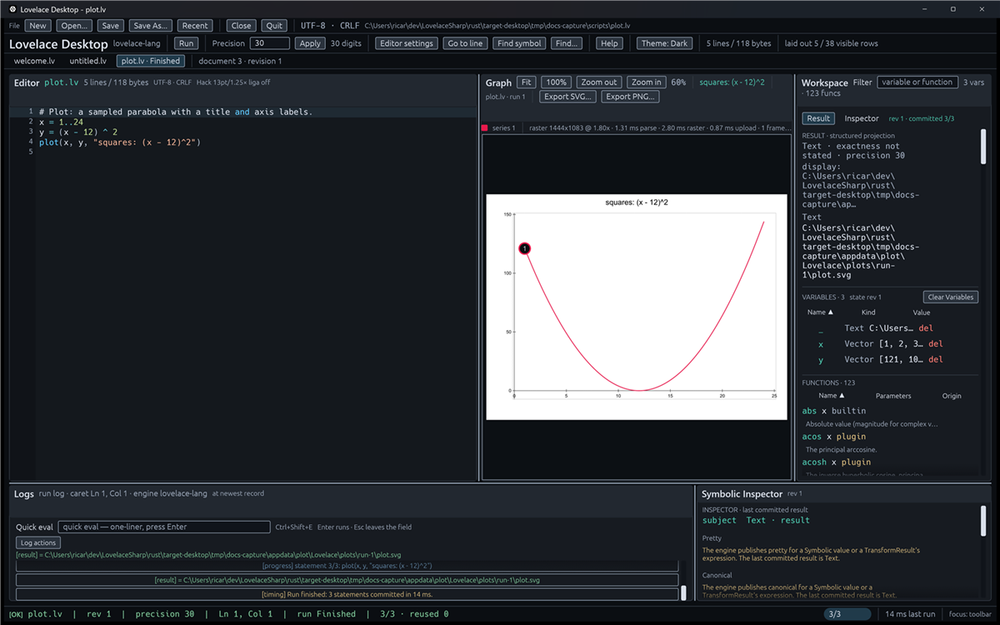

# Architecture

RustLace is one workspace of thirteen crates arranged as five layers. Each layer may depend only on
the ones below it; the dependency graph is in `Cargo.toml` of each crate and is reproduced here.



## 1. Values (`lovelace-json`, `lovelace-nat`, `lovelace-int`)

`lovelace-nat` stores a natural number as a little-endian array of base-2^64 limbs with no
most-significant zero limb; zero is the empty array (`lovelace-nat/src/lib.rs`). Multiplication
switches to an NTT for large operands (`lovelace-nat/src/ntt.rs`), square roots go through
Burnikel–Ziegler/Newton (`lovelace-nat/src/bz.rs`, `newton.rs`), and `digit_store` keeps the
decimal-digit view the wire contract publishes (`lovelace-nat/src/digit_store.rs`).

`lovelace-int` is a sign plus a `Nat` magnitude with no negative zero; division truncates toward zero
and takes the dividend's sign, and division by zero returns `None` (`lovelace-int/src/lib.rs`).

`lovelace-json` is the workspace's only JSON reader/writer. Numbers are kept as their source text so
a numeric field is reproduced byte-for-byte instead of round-tripping through binary floating point
(`lovelace-json/src/lib.rs`).

**Invariant.** No floating point appears in any value path. `#![forbid(unsafe_code)]` guards
`lovelace-array`, `lovelace-int`, `lovelace-know`, `lovelace-json`, `lovelace-nat`, `lovelace-real`,
`lovelace-symbolics`, `lovelace-lang`, `lovelace-corpus` and `lovelace-bench`; `lovelace-desktop`
carries `#![cfg_attr(not(windows), forbid(unsafe_code))]`, so the whole crate forbids unsafe code on
non-Windows targets. `lovelace-run` carries `#![deny(unsafe_code)]`; its sole allowed lane is the
Windows terminal module in `src/repl.rs` (three kernel32 console calls, documented with SAFETY
comments and validated handles).

## 2. Numeric kernels (`lovelace-real`, `lovelace-array`, `lovelace-symbolics`)

`lovelace-real` stores `int * 10^exp` plus optional period metadata: a repeating decimal keeps the
repeating block once, so `1/3` renders `0.(3)` and is never rounded
(`lovelace-real/src/lib.rs`). Arithmetic on terminating values works on scaled integers; an
operation involving a period converts to an exact rational first. `Real::sqrt` and `Real::pi` live in
`transcendental.rs`, with a fixed-width fast path in `fast_path.rs` gated by
`lovelace_lang::complex::FAST_PATH_MAX_DIGITS` (37).

`lovelace-array` is a generic, row-major `NdArray<T>` with shape algebra, indexing, slicing,
reductions and elementwise operations expressed over the `Field` trait
(`lovelace-array/src/lib.rs`). `dense.rs` adds the typed `DenseArray`/`Precision` surface.

`lovelace-symbolics` owns canonical expressions (`Expr`), exact rationals (`Rat`), term ordering,
printing, differentiation, series, polynomial algebra, Gröbner bases and the cooperative
cancellation token that every long kernel polls (`lovelace-symbolics/src/lib.rs`).

## 3. Language and engine (`lovelace-lang`)

`lovelace-lang` is the whole language: values, lexer, parser, tree-walking interpreter, the builtin
registry and the builtin implementations, MathIR, complex arithmetic, SVG plotting and progress
reporting. The engine facade is `Engine` and its evaluation entry point is
`Engine::eval` → `eval_text`. There is one static builtin registry and one dispatcher; the
`module` label on a descriptor groups a function for discovery and is never consulted to decide
whether a name resolves.

Two seams matter for every host:

- **Precision.** `Engine::precision` is the computation digit budget (default 1000, `Engine::new`);
  `Engine::display_precision` separately bounds how many fractional digits are *printed*. A host
  may pin the display bound without touching computation.
- **Cancellation.** `Engine::set_cancel_after` arms a deadline and `Engine::set_cancel_flag` arms a
  live flag. Both are scoped into `lovelace_symbolics::cancel::arm_with_flag` for the duration of
  one evaluation (`Engine::eval`).

## 4. Systems models (`lovelace-systems`)

`lovelace-systems` is an exact queueing and operations-research library: rational arithmetic
(`numeric::Q` over `Nat`/`Int` with gcd reduction), units, typed models, validation, M/M/1, M/M/c,
M/M/∞, operational laws, open Jackson networks, exact single-class MVA, bottleneck/capacity
analysis and sweeps. Every result carries its model class, solver name and version, assumptions,
exactness status, precision and warnings. Unsupported models and unstable systems are stable
categorized errors, never fabricated steady-state metrics. It depends only on the numeric crates;
the `sys_*` adapter in section 3 is the only interpreter code that knows it exists.

## 5. Execution hosts (`lovelace-run`, `lovelace-know`, `lovelace-corpus`, `lovelace-bench`)

`lovelace-run` is the non-interactive runner and the agent-facing wire protocol: exactly one JSON
document on stdout, a stable field set and three exit codes (0 success, 1 script/diagnostic failure,
2 usage), with `--text` for human output (`lovelace-run/src/main.rs`). Positions in the envelope
are UTF-16 code-unit offsets into the caller's text.

`lovelace-know` is the observation-driven behavioural graph: proposal → real `lovelace-run` process
over stdin/stdout → observation → reducer → convergence, with JSON persistence
(`lovelace-know/src/lib.rs`).

`lovelace-corpus` is the documentation-corpus gate: it runs every example in
`parity/corpus/*.json` and compares the rendered text; a missing corpus is a failure, never an empty
pass (`lovelace-corpus/src/main.rs`). `lovelace-bench` is the micro-benchmark harness shared with
the C# reference's measurements (`lovelace-bench/src/main.rs`).

## 6. UI (`lovelace-desktop`)

The desktop binary has a windowed workbench and a set of headless modes
(`lovelace-desktop/src/main.rs`). The window is eframe/egui 0.37 with resvg 0.50 rendering the
engine's SVG into a texture; the Win32/AccessKit adapter lives only in `src/win32` and
`src/ui/a11y.rs`. The workbench state is headless and testable: `Workbench::poll`, `run_active` and
`cancel_active` are the three methods the window and `--gui-selftest` both drive
(`lovelace-desktop/src/workbench.rs`).



## Threading model

| Thread | Owns | Never does |
|---|---|---|
| UI (winit/eframe) | painting, input, pane state, document buffers | evaluation, file I/O beyond save, rasterisation |
| Run worker (one per active run) | one engine instance created from the factory, statement slicing, incremental plan, event emission | touching panes directly |
| Plot canvas worker | resvg rasterisation of an engine SVG | evaluation |
| Recovery journal (caller thread) | atomic `.lvrec` writes on a debounce | blocking the UI for a write |

A run is submitted per document, and one document may have only one active run
(`SubmitError::Busy`). Results are published as typed `DesktopEvent`s and applied through an
`EventSink` that ignores results from a stale source revision. The final state – snapshot and
incremental cache – is settled **before** the terminal event is observable (`ExecutionHost`), so a
client that submits the next run the moment it sees `Finished` cannot race the cache hand-back.

## Cancellation

Cancellation has two seams and the documentation keeps them distinct:

1. **Statement boundary.** Every top-level statement is preceded by
   `lovelace_symbolics::cancel::check()` in `eval_text`. A script stops before the
   next statement, which is exactly the web Studio's contract.
2. **Inside a kernel.** Long operations poll the same token between limbs or iterations:
   `pow`/`factorial` (`lovelace-lang/src/cancellable.rs`), the transcendental kernels, and the
   `progress` sink that reports phase/fraction (`lovelace-lang/src/progress.rs`).

The cancellation result is a structured `LangError` with code `Cancelled` and category
`BudgetExceeded` (`cancelled_error`). A kernel with no poll seam cannot be interrupted;
the desktop reports that as "the in-flight statement completed" rather than pretending it stopped
(`InFlightCancellation`).



## Incremental cache

A run is sliced into top-level statements (`lovelace-desktop/src/statements.rs`). Each statement gets
a `StatementKey` made of the normalized source, the submitted and effective precision, the ordered
dependency values and the function revisions. The key is
built from full canonical strings, never digests, so a hash collision cannot reuse a different
statement. A statement that mentions a side-effecting builtin is never cached, and a cache hit is
reported as reused only after the cached typed value was actually applied to the run's fresh engine
(`apply_cached`). The cache is per document and bounded at 4096 entries (`ENTRY_LIMIT`).

## Data flow of a run

```text
Run button / Ctrl+Enter
  → Workbench::run_active
  → ExecutionHost::submit(DocumentId, SourceRevision, source, precision)
  → worker thread: new engine from the factory, precision applied
  → ProgramAnalysis slices statements; DocumentCache plans each one
  → per statement: reuse (apply cached typed value) or Engine::eval
      → lexer → parser → interpreter → builtins → lovelace-real/nat/array/symbolics
      → print() lines, plot capture, diagnostics, progress reports
  → DesktopEvent::StepCommitted / Finished / Failed / Cancelled
  → Workbench::poll applies the event; WorkspaceSnapshot replaces the pane state
  → egui repaint: editor, graph (resvg texture), workspace tables, logs, inspector
```



The graph pane is fed by the same snapshot: the engine wrote the SVG during the run, and the pane
rasterises those bytes with resvg — it never regenerates the plot.



## Persistence

Everything the application writes outside a document lives under one application directory:
`%APPDATA%\Lovelace\desktop.json` (settings), `plots\`, `recovery\` on Windows;
`$XDG_CONFIG_HOME/lovelace` or `~/.config/lovelace` on Linux
(`app_dir_from`, `default_plot_dir`, `recovery.rs`). Saves are atomic – a temporary
file in the target's own directory, flushed, `sync_all`ed, then renamed over the target
(`document_io::write`). The recovery journal applies the same write-then-rename
discipline to `LOVELACE-RECOVERY` records (`RecoveryRecord::write_atomic`).
