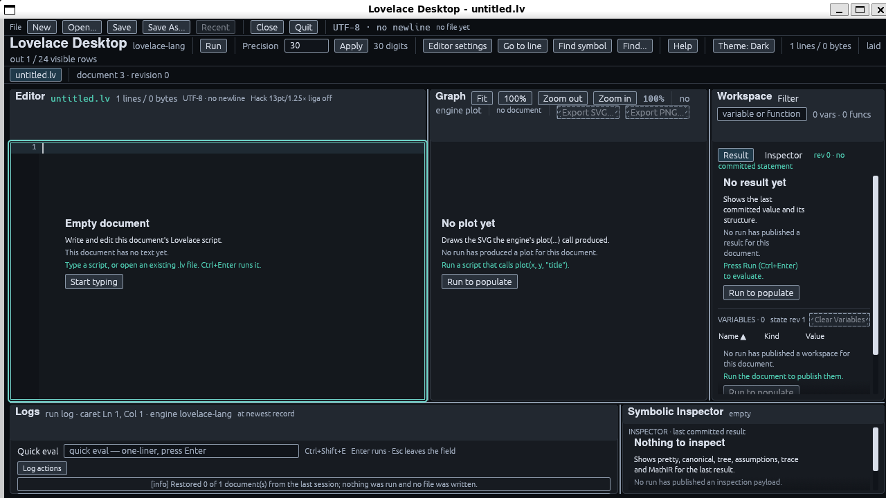
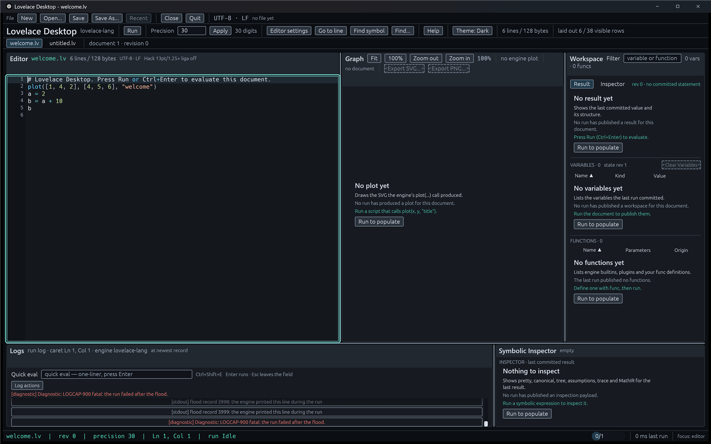

# Build and run

## Prerequisites

| Requirement | Why | Notes |
|---|---|---|
| Rust 1.85 or newer | `rust-version = "1.85"`, edition 2024 (`Cargo.toml`) | The documented runs used rustc/cargo 1.99.1 |
| MSVC build tools (Windows) | `link.exe` for every binary | Present as Visual Studio 2022 Build Tools on the documenting host |
| A desktop session (Windows, or X11 on Linux) | the native workbench | Windows uses eframe's default wgpu renderer, Linux compiles and selects glow; the packages are in [Linux](#linux) |
| A crate registry reachable once | the desktop's GUI stack | `eframe`/`egui` 0.37, `resvg` 0.50, `raw-window-handle` 0.6; everything else is in-tree |

No registry is needed for the engine, the runner, the corpus gate or the knowledge graph
(ADR-001).

## Build

```console
$ cargo build --workspace
```

The workspace has twelve members; `lovelace-desktop-spike` is deliberately outside it and is not
built by this command (`lovelace-desktop-spike/Cargo.toml`).

Profiles (`Cargo.toml`):

- `dev` – unoptimized with debuginfo. This is what `cargo build` and `cargo test` use.
- `release` – `opt-level = 3`, `lto = "thin"`, `codegen-units = 1`.

```console
$ cargo build --release -p lovelace-desktop
   Finished `release` profile [optimized] target(s) in 1m 34s
```

The release binary is `target/release/lovelace-desktop.exe` on Windows and
`target/release/lovelace-desktop` on Linux (the same command, one `main` for both platforms).

## Run the CLI

```console
$ cargo run -p lovelace-run -- --eval "1/3" --text
= 0.(3) (Real)

$ cargo run -p lovelace-run -- --eval "1/3"
{"artifacts":[],"elapsed":"407.1 µs",...,"result":{"display":"0.(3)","kind":"Real",...,"typed":"0.(3) (Real)"},...}
```

Sources: `--eval <src>`, `--file <path>`, `--stdin`, or a bare script path. Options include
`--plot-dir`, `--plot-file`, `--cancel-after <ms>`, `--print-budget <n>`, `--omit-functions`,
`--omit-variables`, `--functions [pattern]`, `--function <name>`, `--function-limit <n>`, `--repl`,
`--json` and `--text` (`usage`). Exit codes: 0 success, 1 script or diagnostic
failure, 2 usage.

## Run the desktop

```console
$ cargo run -p lovelace-desktop                  # the workbench
$ cargo run -p lovelace-desktop -- notes.ls      # opened on a file
$ cargo run -p lovelace-desktop -- --gui-selftest
$ cargo run -p lovelace-desktop -- --help
```

The window writes its start-up line to stderr so a redirected launch still shows where plots go:

```text
lovelace-desktop: plot directory C:\Users\<you>\AppData\Roaming\Lovelace\plots
lovelace-desktop: plot directory /home/<you>/.config/lovelace/plots        # Linux
```

On Windows at 300% scale the window is a 4800x3000 physical window whose logical layout is
1600x1000; the Windows screenshots in `docs/images` are that frame resampled to 1600x1000 (see
`docs/images/README.md`). The Linux run and capture are in [Linux](#linux).

## Linux

The workbench is not a Windows-only build: `cargo build --release -p lovelace-desktop` produces the
same workbench on Linux (one `main`, no headless-only refusal path), and CI builds it, runs
`--gui-selftest` and runs the desktop tests under Xvfb. The engine, the CLI and the corpus gate were
already platform-independent.



### The prebuilt artifact needs glibc 2.39

The binary CI publishes (`lovelace-desktop-linux-gui-x86_64`) is built on **Ubuntu 24.04**, the
current LTS, so it needs **glibc >= 2.39** — it runs on Ubuntu 24.04 and newer, and on any other
distribution whose libc is at least that new. On a host with an older libc the loader refuses it
before `main()` (`version 'GLIBC_2.39' not found`), which is the same failure an earlier build gave
on 24.04 when the runner had moved past the LTS and produced a `GLIBC_2.43` binary. **Older
distributions should build from source instead**; the packages in [Packages](#packages) are the
whole requirement, and `cargo build --release -p lovelace-desktop` then uses the host's own libc:

```console
$ git clone https://github.com/jjackbauer/RustLace
$ cd RustLace
$ cargo build --release -p lovelace-desktop
```

Two guards keep that floor honest. The `linux` job is pinned to `runs-on: ubuntu-24.04` rather than
`ubuntu-latest`, because the publishing runner fixes the artifact's ABI floor and the `latest` label
had already moved ahead of the LTS. And a `Guard the artifact's glibc requirement` step reads the
newest `GLIBC_2.x` in the built binary's dynamic symbol table (`objdump -T`), prints that and the
runner's own `ldd --version`, and fails when the artifact needs more glibc than the runner provides
— so "the artifact outruns the LTS" is a CI failure, not a user-facing surprise.

### Packages

The GUI stack loads X11, GL and xkbcommon at run time (`dlopen` through winit, glutin and
xkbcommon-dl), so the **build** does not link against them; a machine that only runs the headless
modes needs none of this either. To open the window on a Debian/Ubuntu host, install:

```console
$ sudo apt-get update
$ sudo apt-get install -y libxkbcommon-dev libxkbcommon-x11-0 libx11-dev libxcursor-dev \
    libxrandr-dev libxi-dev libgl1-mesa-dev libegl1-mesa-dev libgl1-mesa-dri \
    libwayland-dev pkg-config fonts-urw-base35 xvfb xauth x11-utils x11-apps
```

- `fonts-urw-base35` is a real product dependency, not a test detail. The strong type roles need a
  face whose own line box is at least 1.15x at their size; `NimbusSans-Bold.otf` (URW base35, 1.20
  em) satisfies it and the DejaVu faces do not. Without it the strong-role test fails with
  `measured row 17.00 is below 1.15x15.00`, and `--legibility-check` fails on the same roles. The
  Windows build tries `seguisb.ttf`/`segoeuib.ttf` first and is unchanged (`STRONG_FACES`).
- `libgl1-mesa-dri` is mesa's software GL (llvmpipe), the renderer on a machine with no GPU such as
  a CI runner under Xvfb or WSLg.
- `xvfb` and `xauth` are for the display-less runs (`xvfb-run`); `x11-utils` (`xwininfo`) and
  `x11-apps` (`xwd`) are for the capture below.

### The renderer split

`eframe` 0.37's default feature set is wgpu-only, and Windows has always shipped exactly that: the
Windows build keeps the default feature set and the default `wgpu` renderer, and nothing here
changes it. The non-Windows build compiles eframe's `glow` (OpenGL) backend as well
(`lovelace-desktop/Cargo.toml:39`), and `ui::native_options` selects `eframe::Renderer::Glow` there
(`lovelace-desktop/src/ui/app.rs`).

The reason is the host, not a preference. Under WSLg there is no `/dev/dri`, and the wgpu path dies
with `WGPU error: Parent device is lost` (`MESA: error: ZINK: failed to choose pdev`), while the GLX
path through mesa llvmpipe renders. Glow is the backend this tree verifies on Linux; a Linux machine
with a working Vulkan/EGL device might also run wgpu, but choosing it there would be a claim no run
in this tree supports. `Renderer::Glow` does not exist in a Windows build (the variant is behind the
`glow` feature), so the two paths cannot be mixed at compile time.

### Run it, and the WSLg caveat

```console
$ export DISPLAY=:0
$ unset WAYLAND_DISPLAY
$ cargo run --release -p lovelace-desktop -- notes.ls
```

`WAYLAND_DISPLAY` matters under WSLg: when it is set, winit selects the Wayland backend, WSLg's
socket is missing, and the process fails with `Io error: Connection reset by peer (os error 104)` and
`winit EventLoopError: Exit Failure: 1`. With `WAYLAND_DISPLAY` unset the same binary opens its
window through X11/GLX. A native Wayland session is not tested by this tree; unset the variable only
where the Wayland socket is missing.

To capture the window with the X11 tools:

```console
$ ./target/release/lovelace-desktop &
$ xwininfo -root -tree | grep "Lovelace Desktop"    # the window id and its geometry
$ xwd -root -display :0 -out /tmp/gui.xwd
$ xwdtopnm /tmp/gui.xwd | pnmtopng > /tmp/gui.png
```

`xwd` exits 0 once a window is mapped; WSLg's XWayland answers `BadMatch` when none is. The
screenshot above is `docs/images/gui-linux.png`, a real root capture of the release binary on WSLg:
1280x720, the full workbench, with the right edge of the default 1280x800 window clipped by the
virtual screen.

On a display-less machine, `xvfb-run` supplies an X server. That is how CI accepts the GUI:

```console
$ xvfb-run -a -s "-screen 0 1600x1000x24" ./target/release/lovelace-desktop --gui-selftest
GUI_SELFTEST summary checks=20 failed=0

$ xvfb-run -a -s "-screen 0 1600x1000x24" cargo test -p lovelace-desktop
```

`--gui-selftest` needs no window (it drives the workbench run path directly, exactly as on Windows);
the writable application directory it uses is `$XDG_CONFIG_HOME/lovelace` or `~/.config/lovelace`.

### What stays Windows-only

`--legacy-win32`, `--ime-probe` and `--platform-parity` are Win32 code and are refused by name on
Linux with exit 2 (the mode dispatch in `main`). Everything else in the
mode table runs on Linux, including `--journey`, `--raster-svg` and the audit modes; `--selftest`
reports 14 checks, 0 failed and one named skip (`no-network-imports` reads a PE import table).

File dialogs use `zenity`, then `kdialog`, as a blocking child process
(`lovelace-desktop/src/platform_dialogs.rs`); the chosen path comes from stdout, and a missing
chooser returns the same `None` as the Windows `IDCANCEL`, never a fabricated path.
`LOVELACE_FILE_DIALOG=zenity` or `=kdialog` pins the tool. With neither installed, Open/Save behaves
as a cancel.

## Environment

| Variable | Effect | Source |
|---|---|---|
| `APPDATA` | Root of the application directory: `desktop.json`, `plots\`, `recovery\`. On Linux the root is `$XDG_CONFIG_HOME/lovelace` or `~/.config/lovelace` | `app_dir_from`, `default_plot_dir` |
| `LOVELACE_THREADS` | Pins the worker budget for determinism experiments | `thread_budget` |
| `LOVELACE_NTT_THRESHOLD` | Pins the NTT crossover without rebuilding | `ntt_threshold` |
| `LOVELACE_FACTORIAL_LEAF` | Pins the factorial product-tree leaf size | `factorial_leaf` |
| `LOVELACE_RUN` | Path to the runner the knowledge graph spawns | `resolve_runner` |
| `LOVELACE_RECORD_GOLDENS` | `=1` rewrites the golden wire fixtures instead of comparing | `RECORD_ENV` |
| `LOVELACE_RUN_TRACE` | File (or `stderr`) that receives one line per run mark | `run_trace::mark` |
| `LOVELACE_MEASURE_TRACE` | Per-pass CSV path for the measurement modes | `FrameTrace` |
| `LOVELACE_ENGINE_FAULT` | `panic-once` injects one engine panic (RUN-017 recovery capture) | `FAULT_ENV` |
| `LOVELACE_PLOT_FAULT` | `malformed` or `oversized` corrupts the plot capture | `faulted_capture_svg` |
| `LOVELACE_LOG_FLOOD` | `<n>` appends n stdout records and one fatal at launch | `Workbench::flood_log_active` |
| `LOVELACE_LOG_START_SCROLLED` | Starts the log view away from the newest record | `log_force_scrolled` |
| `LOVELACE_IME_NO_SHORTCUT` | `=1` skips the shortcut-during-composition probe | `ProbeApp::step` |
| `LOVELACE_PROBE_DWMFLUSH` | `=1` blocks on `DwmFlush` once per frame probe pass | `compositor_flush` |

The `LOVELACE_*_FAULT`, `_FLOOD` and `_START_SCROLLED` switches are acceptance seams: they exist so a
test can reach a state a script cannot, and none of them is on by default. `LOVELACE_LOG_FLOOD=4000`
produces the flooded log below — tail-follow at the newest record, ending in the injected fatal
diagnostic.



## Troubleshooting

**`link.exe` fails with `LNK1104: cannot open file '...\Temp\lnk{...}.tmp'`.** The documenting host
denied the linker its `%TEMP%` scratch files. Point `TMP`/`TEMP` at a writable directory before
building:

```powershell
$env:TMP = "$PWD\.tmp"; $env:TEMP = $env:TMP
cargo build --workspace
```

**`failed to remove file ... lovelace-desktop.exe: Access is denied`.** A previous desktop process
still holds the binary. Close it (or `Stop-Process -Name lovelace-desktop`) and rebuild.

**The desktop builds but no window appears (Linux).** winit probably selected Wayland: under WSLg
unset `WAYLAND_DISPLAY` and set `DISPLAY=:0` (see [Linux](#linux)). The acceptance mode needs no
window, so `./target/release/lovelace-desktop --gui-selftest` still runs and tells you whether the
workbench itself is healthy.

**`--legibility-check` fails on the strong roles on Linux.** No installed face has a line box tall
enough (the strong-role test reports `measured row 17.00 is below 1.15x15.00`); install
`fonts-urw-base35` (see [Linux](#linux)).

**`Cannot create the plot directory ... Access is denied`.** The log pane reports it at start-up; the
process could not create `%APPDATA%\Lovelace\plots`. Set `APPDATA` to a writable directory. Plot
statements then fail with that message rather than silently writing nowhere (`prepare_plot_dir`).

**`cargo build` cannot reach a registry.** The engine and the CLI do not need one. The desktop does:
its GUI stack is the only external dependency (`eframe`/`egui`, `resvg`, `raw-window-handle`), and
it is declared in the desktop crate only.

**A settings file written by a newer build.** `Settings::from_json` has no error return: an unknown
schema, a wrong field type or a corrupt file yields the defaults plus a warning
(`lovelace-desktop/src/settings.rs`).
