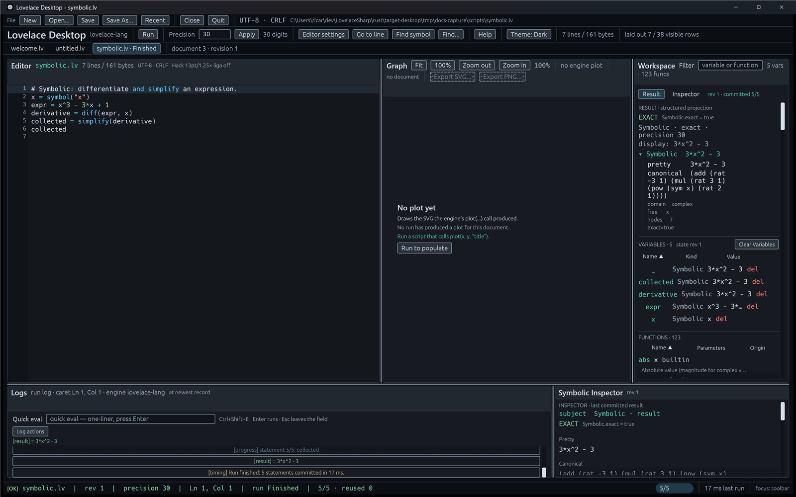
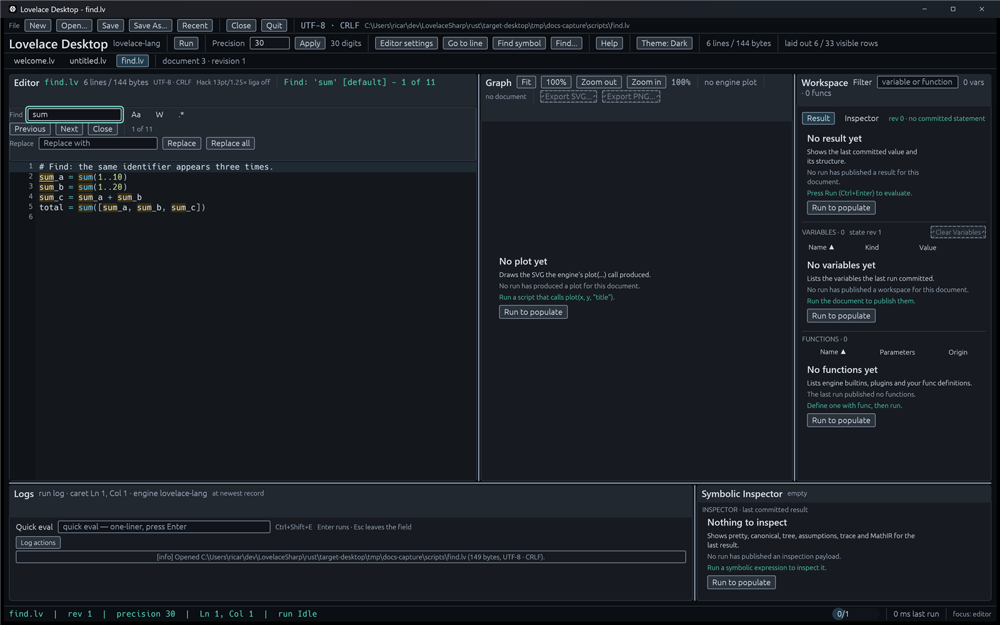

# `lovelace-desktop`

The native desktop IDE for the Lovelace scripting language, on Windows and Linux: a windowed
workbench plus its headless acceptance modes.

## Purpose

The binary has a windowed mode (eframe/egui 0.37, resvg 0.50) and headless modes that drive the same
run path the window uses, so acceptance can run on a build host without a human at the keyboard
(`lovelace-desktop/src/main.rs`).

| Mode | What it does |
|---|---|
| default `[script.ls]` | the native workbench, optionally opened on a file |
| `--gui-selftest` | headless acceptance of the workbench run path (the same `Workbench` methods) |
| `--journey <ID> [--out <dir>]` | the implemented journeys (J-02, J-03, J-07, J-08, J-09, J-10, J-15) against `docs/goal-desktop-v4/journeys.md` |
| `--selftest` | the pre-cutover headless acceptance of the application core |
| `--raster-svg <in.svg> --out <out.png> [--scale N]` | rasterise one SVG exactly as the plot pane does |
| `--contrast-check` | every dark/light token pair's WCAG ratio; fails below 4.5:1 / 3:1 |
| `--legibility-check` | type scale and legibility report (min 11 pt, 1.2× line ratio, 4.5:1) |
| `--visual-audit` | design-system tables printed from the constants the window paints with |
| `--glyph-check` | no-tofu report for the mathematical glyph set |
| `--ui-audit` | source audit over `src/ui` (no evaluation, no engine construction) |
| `--thread-audit` | source audit over every thread spawn, sleep and sync primitive |
| `--shortcuts` | the keyboard map, generated from `keyboard::BINDINGS` |
| `--platform-parity` / `--platform-claims` | platform behaviour report and the release matrix's claims |
| `--measure-*`, `--perf-*` | startup, typing, scroll, run responsiveness and precision probes |
| `--ime-probe`, `--raster-svg` | IME probe and SVG rasteriser |

### Structure

`execution.rs` (background runs, typed events), `workbench.rs` (headless document state),
`incremental.rs` (the statement cache), `statements.rs` (the slicer), `document_io.rs` + `recovery.rs`
(files), `settings.rs`, `engine/` (`Evaluator` trait, `RealEngine`, deterministic `FakeEngine`,
fault injection), `ui/` (window, editor, plot, theme, type scale, accessibility), `win32/` (FFI and
the shell).

## Inputs

### Public surface

A binary crate: no library target. The `Evaluator` trait (declared in `lovelace-desktop/src/engine.rs`) is the seam a host would
implement to drive the app with another engine; `Workbench` (`workbench.rs`) is the headless state a
test drives.

### Dependencies

`lovelace-json`; `lovelace-lang` and `lovelace-symbolics` behind the default `real-engine` feature;
`eframe`/`egui` 0.37, `resvg` 0.50 and `raw-window-handle` 0.6, declared in this crate only. eframe
keeps its default wgpu renderer on Windows and adds the `glow` feature on other platforms. A
`--no-default-features` build keeps the crate usable offline and switches every document to
`engine::FakeEngine` (`lovelace-desktop/Cargo.toml`).

## Outputs

The default mode opens the workbench window, optionally on a file. A headless mode prints its report
to stdout and exits with that mode's status; `--journey` also writes its artifact directory under
`--out`, and `--raster-svg` writes the PNG named by `--out` at `--scale`. `--shortcuts`,
`--visual-audit`, `--platform-parity`, `--platform-claims`, `--glyph-check`, `--contrast-check`,
`--legibility-check`, `--ui-audit` and `--thread-audit` are report surfaces: their output is the
result. The panes the window publishes are the product's whole surface, and a run's structured
projection arrives in the inspector pane.

## Precision behaviour

The workbench does not evaluate or construct an engine — `--ui-audit` enforces that — so every number
it displays is the engine's rendering, delivered through `WorkspaceSnapshot`/`DocumentView`, and the
exactness of a value is the engine's, not the UI's. The inspector adds the pretty and canonical forms
of the same expression and never mutates it. `--contrast-check` and `--legibility-check` compare
token ratios and type metrics against their published thresholds; those are accessibility
measurements, not numeric results. `--raster-svg` changes the pixel size of a rendering with
`--scale`, not the values in it, and `--perf-*`/`--measure-*` report host observations of a build, not
published performance claims.

## Errors

- A mode that finds a problem reports it and exits non-zero: `--contrast-check` fails below its
  ratios (4.5:1, or 3:1 for the large/non-text pairs), `--legibility-check` below its minimums (11 pt,
  1.2× line ratio, 4.5:1), and the audits report their findings in the same table.
- An unknown or incomplete mode argument exits 2 with the mode's usage.
- `--journey` fails when a journey step's assertion fails; a passing run writes its artifacts and
  exits 0.
- The headless modes report through their own result line; they do not raise a `LangError`, because
  they are not language calls.

## Limitations

- **No library target.** The crate is a binary; the programmatic seams are the `Evaluator` trait and
  `Workbench`, not a stable public library API.
- **The UI never evaluates.** The window paints values the engine produced; a host that wants
  different language behaviour changes the engine, not the UI.
- **Two GUI renderers by platform.** Windows keeps eframe's wgpu renderer and non-Windows compiles
  `glow`; the split is deliberate because wgpu cannot acquire a device on a host with no `/dev/dri`.
- **A `--no-default-features` build cannot evaluate scripts.** It switches every document to the
  deterministic `FakeEngine`, which is an offline acceptance seam, not a real evaluator.
- **A headless selftest is not a GUI journey pass.** `--gui-selftest` exercises the same run-path
  methods, but neither it nor `--selftest` captures or drives a window; the platform claims and the
  journey modes are the evidence for those claims.
- **The workbench needs a windowing environment.** On Linux it needs X11/GL and, on a display-less
  host, Xvfb; the headless modes are how acceptance runs there.

## Examples

### Using it

```console
$ cargo run -p lovelace-desktop                 # the window
$ cargo run -p lovelace-desktop -- notes.ls     # the window, opened on a file
$ cargo run -p lovelace-desktop -- --gui-selftest
$ cargo run -p lovelace-desktop -- --shortcuts
```

The panes the run publishes are the product's whole surface. A symbolic result fills both the
workspace's structured projection and the inspector pane:



Editing is served by the same panes — the docked find bar works on the active document and reports
its match count:



### Tests

The suite's measured counts are in [testing.md](../testing.md#1-unit-tests-in-crate-test): the Linux
run was measured under `xvfb-run` at v0.4.1, and the Windows count was not measured in this
environment. `cargo test -p lovelace-desktop` runs it; the tests cover the execution host, the
incremental cache, statements, documents and files, recovery, settings, the theme and contrast
checker, the type scale, the editor model, completion, find, the workspace tables, the inspector,
the plot pane and the UI audits.
