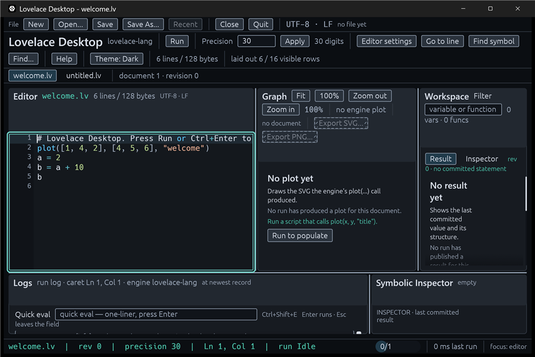
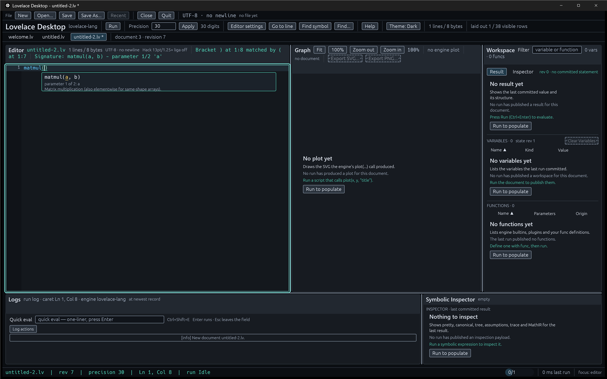

# Extending RustLace

Five walkthroughs, each naming the files to touch and the command that proves the change. The rule
for all of them: the engine is the single source of behaviour, and a host that re-implements it is a
bug.

## 1. Add a builtin

1. **Declare the descriptor** in `lovelace-lang/src/registry.rs`. Add a `BuiltinInfo` entry to
   `BUILTINS` in name order: `name`, `parameters`, `min_arity`, `parameter_count`, `variadic`,
   `plugin` (`None` for a core builtin), `category`, `summary`, `return_kind`, `related`, `examples`.
   This one table feeds the wire's `functions` array, `--functions`, `--function`, the help dialog
   and completion, so a builtin that is missing here is invisible to every host
   (`registry.rs:1`).
2. **Implement the call** in `lovelace-lang/src/builtins.rs`, as a new arm of the `match name` in
   `pub fn call` (`builtins.rs:1300`). Enforce the declared arity with the existing `arity(n)?`
   helper, check argument kinds explicitly, and return `Value`. Refusals are structured:
   `LangError::coded(message, pos, "InvalidArgument", "TypeMismatch")` or the category that actually
   applies (`lovelace-lang/src/diagnostic.rs`).
3. **If it belongs to a plugin**, set `plugin: Some("Lovelace.Symbolics")` (or `Dsp`, `MathIR`) and
   make the plugin's `register` install it, so a bare engine only gains it when that plugin loads.
4. **Test it** in a `#[test]` in the relevant `roundNN_*.rs` or `suite_*_batch.rs`, and add a corpus
   record if the behaviour is documented (walkthrough 5).
5. **Prove it end to end**:

   ```console
   $ cargo run -p lovelace-run -- --function <name>
   $ cargo run -p lovelace-run -- --eval "<a call>" --text
   ```

## 2. Add a Modus plugin

1. **Implement the trait** `lovelace_lang::modus::ModusPlugin` (`modus.rs:927`): `name()` and
   `register(&mut self, host: &mut ModusHost)`. Call `host.register_builtin(name, parameters, impl)`
   and, for elementwise work, `host.register_kernel::<T>(kernel)` with a `FieldKernel<T>`.
2. **Model it on a shipped plugin**. `lovelace-lang/src/round67_modus.rs` contains the smallest
   complete examples: `StatisticsPlugin` (2 builtins), `ScalarResultPlugin`, `DspPlugin`,
   `ShadowingPlugin`, `ArityPlugin`, `RecordPlugin`, `SymbolicsContextPlugin`.
3. **Load it** with `Engine::new_bare()` followed by `Engine::load_plugin(&mut plugin)`
   (`lib.rs:883`). A bare engine advertises only core builtins plus the plugins it has loaded; the
   full engine already has all of them.
4. **Assert the advertisement**: `registry::builtin_count_for_plugins(&["Lovelace.X"])` must equal the
   core count plus that plugin's descriptors, and the loaded plugin must appear in the envelope's
   `functions[].plugin`.

## 3. Add a UI pane

1. **Add the focus group** to `Pane` in `lovelace-desktop/src/keyboard.rs:279` (and to `Pane::ALL` so
   F6 reaches it). Each group focuses its first control.
2. **Lay it out** in `lovelace-desktop/src/ui/app.rs`: the shell is five egui panels –
   `Panel::top("filebar")`, `Panel::top("toolbar")`, `Panel::top("tabstrip")`,
   `Panel::bottom("status")` and one `CentralPanel` (`app.rs:3864`–`3909`). A new pane belongs in the
   central split (`ui/empty.rs` supplies the empty state, `ui/control.rs` the widgets).
3. **Paint from tokens only.** Every colour comes from `ui/theme.rs`; that module is the only place
   in `ui/` allowed to construct a `Color32`, and a test enforces it (`theme.rs:9`). Text sizes come
   from `ui/type_scale.rs`.
4. **Expose it to accessibility** through the AccessKit helpers in `ui/a11y.rs` (role, name, value,
   state) so `--ui-audit` and the UIA harness can see it.
5. **Keep the separation audit green**: files under `src/ui/` must not evaluate, construct an engine
   or name the compiler (`--ui-audit`, `src/ui_audit.rs`). Pane data arrives through
   `WorkspaceSnapshot`; the UI never calls the engine.
6. **Test it** with a unit test in `ui/app.rs` and check the ASCII/Unicode and 200% scale states
   (`layout-compact-200.png` is the reference for the compact layout).



The editor itself has the same shape of extension point: a new popup or decoration is painted by
`ui/editor.rs` from data the workbench publishes, and it appears in the accessible tree like the
signature help below.



## 4. Add a diagnostic

1. **Pick the category** from the seven frozen members in `lovelace-lang/src/diagnostic.rs:12` –
   `ParseError`, `DomainError`, `UnsupportedOperation`, `BudgetExceeded`, `NoSolution`,
   `TypeMismatch`, `InternalInvariantFailure`. The order and the names are contract; do not add a
   member.
2. **Construct it** with `LangError::coded(message, position, "StableCode", "Category")`. The message
   is a complete sentence ending with a period, and `position` is a UTF-16 code-unit offset into the
   caller's source (`lib.rs:1`).
3. **Publish the code** in the error-taxonomy batch tests (`lovelace-run/src/error_taxonomy_batch.rs`)
   so the wire contract keeps naming it, and update the run envelope's schema if a field is added.
4. **Check the UI mapping**: `lovelace-desktop/src/diagnostic_map.rs` turns a message into a
   line/column; a message that names its own position is recovered from it.

## 5. Add a test fixture

- **Documentation corpus** – add a record to `parity/corpus/lang.json`:
  `{id, doc, heading, script, kind, text}` with `kind` ∈ `value | error | prints | plot`. Then
  `cargo run -p lovelace-corpus -- <id>`.
- **Golden wire envelope** – add `<name>.lv` and `<name>.json` under
  `docs/csharp-oracle/Lovelace.Run.Tests/fixtures/`. Regenerate with
  `LOVELACE_RECORD_GOLDENS=1 cargo test -p lovelace-run` (the switch is inert otherwise,
  `golden_batch.rs:94`), then re-run without it to compare.
- **Desktop journey** – add the expected observable to `docs/goal-desktop-v4/journeys.md`, capture
  the reference under `docs/goal-desktop-v4/reference/REF-*.json`, then
  `cargo run -p lovelace-desktop -- --journey J-NN`.
- **Knowledge graph reference** – the frozen C# graph is `knowledge-graph-demo.json` at the
  repository root (seed 20240617); `lovelace-know`'s convergence and graph tests reduce it again
  (`lovelace-know/tests/common/mod.rs`).
