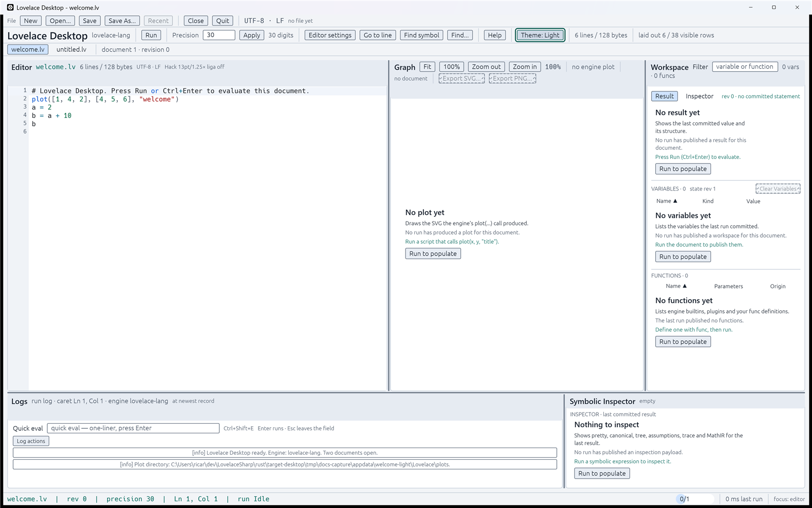
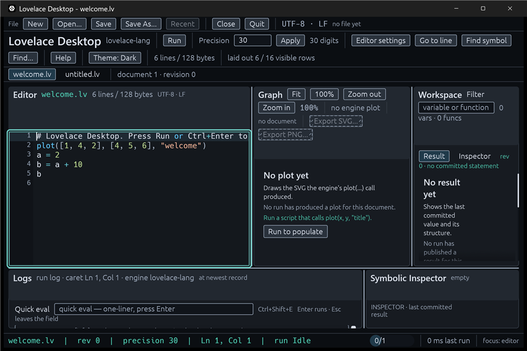

# Parity with the C# Studio

The Rust port answers to the C# implementation, not to the browser. CON-003 from the desktop goal
states the rule: preserve **behaviour and data semantics**, never the transport. This page records
what is preserved, what deliberately differs, and which fixtures pin either claim.

## Preserved

| Surface | What survives | Where it is pinned |
|---|---|---|
| Value semantics | Exact arbitrary-precision arithmetic; `1/3` is `0.(3)`, never a rounding; no floating point in a value path | `lovelace-real`, corpus records |
| Rendering | `<display> (<Kind>)`, period notation, `True`/`False`, `[a, b, c]`, record field order, error sentences | `CONTRACT.md` rendering rules, `parity/corpus/lang.json` |
| Engine API | `SuiteEngine` → `Engine`: eval, typed formatting, variables, functions, output, plot capture, precision, revision | `Engine`, `CONTRACT.md` |
| Plugin model | `ModusHost` → `modus::ModusHost`: descriptors, arity enforcement, typed payloads, field kernels, bare engines | `lovelace-lang/src/modus.rs` |
| Builtin catalogue | The same names, parameter names, categories and arities in one registry table | `lovelace-lang/src/registry.rs`; the envelope advertises 124 functions |
| Symbolics + MathIR | Canonical forms, printing, differentiation, solving, series, compilation | `lovelace-symbolics`, `lovelace-lang/src/mathir.rs` |
| Plot bytes | The engine writes the SVG; a host renders it, never regenerates it | `lovelace-lang/src/plot_surface.rs`, `plot_file.rs` |
| Runner envelope | One JSON document, stable fields, three exit codes, UTF-16 positions | `lovelace-run/src/main.rs` |
| Desktop behaviour | Accepted/refused runs, statement order, per-statement results, reused count, diagnostics, terminal status | `docs/goal-desktop-v4/reference/REF-*.json`, `--gui-selftest`, `--journey` |
| Knowledge graph | Seeded reproduction of the frozen graph (seed 20240617) | `knowledge-graph-demo.json`, `lovelace-know/tests/seed_reproduction.rs` |

## Deliberately different

| Difference | Why | Evidence |
|---|---|---|
| **Desktop default precision is 30 digits**, not 1000 | The C# extension host's untouched knob was 30 computation / 15 display, and 30 is inside the `<= 37` fixed-width gate; 1000 can never enter it | DEV-009, `DEFAULT_PRECISION`, `precision_default.rs` |
| **No HTTP session, no browser** | Native document + worker + typed events replaces `POST /api/evaluate` + polling; parity compares state snapshots, outputs, diagnostics, plot bytes and terminal status, never routes or JSON field names | CON-003 in `docs/goal-desktop-v4/journeys.md`; `lovelace-desktop/src/execution.rs` |
| **Kernel cancellation is possible** | The Studio observes cancellation only at a statement boundary. The desktop keeps that contract *and* polls inside long kernels, so an in-flight statement has two named outcomes: completed, or stopped early | ADR-003, `InFlightCancellation` |
| **Diagnostics carry a code and category** | The oracle's `diagnostics[].code` is empty while the Rust engine carries a coded `LangError`; showing less would be a regression | DEV-005, `lovelace-lang/src/diagnostic.rs` |
| **A syntax error terminates the run** | The oracle never reaches a terminal run state on a syntax error and locks the session (OD-1); reproducing that would make the product unusable | DEV-004, `docs/goal-desktop-v4/reference/oracle-syntax-hang.json` |
| **Files instead of browser storage** | `desktop.json` + `recovery\*.lvrec` replace `localStorage`/`sessionStorage`; the behaviour compared is "unsaved text survives a crash" and "layout restores", not the key names | `settings.rs`, `recovery.rs` |
| **Per-platform release assets** | Every release carries `lovelace-desktop.exe` (Windows x86_64) and `lovelace-desktop-linux-x86_64` (Linux x86_64, glibc >= 2.39), each with its own checksum file (`SHA256SUMS.windows`, `SHA256SUMS.linux`). Both are built at the tagged commit and version-checked. macOS has no port; the matrix claims only what a host has produced | DEV-002, `docs/goal-desktop-v4/platform-matrix.md`; Linux evidence in `docs/images/gui-linux.png` |
| **Accessibility through AccessKit → UIA** | The browser's DOM tree has no native equivalent; roles, names, values, states and keyboard reachability are what parity asserts | `lovelace-desktop/src/ui/a11y.rs`, `--shortcuts` |

## The fixtures that pin parity

- `parity/corpus/lang.json` – 111 records extracted from the C# suite's `Language.md` in the
  LovelaceSharp repository:
  `{id, doc, heading, script, kind, text}` with `kind` ∈ value | error | prints | plot. Run by
  `lovelace-corpus`; a missing file is exit code 2, never a pass.
- `parity/corpus/symbolics.json` – the symbolic corpus, same shape.
- `docs/csharp-oracle/Lovelace.Run.Tests/fixtures/*` – 40 golden wire envelopes and scripts from the
  C# test project, compared byte-for-byte by `lovelace-run`'s `golden_batch`.
- `docs/csharp-oracle/Lovelace.Symbolics/README.md` and
  `Lovelace.Symbolics.Tests/UsageExamples.cs.txt` – the C# documentation oracle for the ported
  `DocsSyncTests` in `lovelace-lang` (the `.cs.txt` suffix keeps the repository free of `.cs` paths).
- `docs/symbolics/dsh-protocol.md` – the protocol examples `lovelace-run`'s `wire_batch` checks
  against the binary.
- `docs/goal-desktop-v4/reference/REF-*.json` (16 captures) and `round-64/REF-cancel.json` – the
  desktop's reference states, captured through the same routes the browser used.
- `knowledge-graph-demo.json` – the frozen C# knowledge graph (seed 20240617), re-reduced by
  `lovelace-know`.
- `lovelace-corpus`'s `dotnet_random` + `property_corpus` – the seven generated corpora with the same
  draw order as the C# property tests, compared by transcript hash.

The fixtures were carried into this repository by the adaptation commit and are described in
[`rustlace-notes.md`](rustlace-notes.md); no test was deleted or relaxed to make them fit. One known
residual is recorded there: `lovelace-lang/src/dsp_round21.rs` ports three C# tests that scan C#
sources for forbidden constructs; those sources are not in this repository, so the scans walk no
files and pass vacuously.

The layout is part of the same parity story: the workbench adapts to the minimum supported window
(900x600) at 200% interface scale without clipping a pane, which is what the browser's responsive
grid did.

